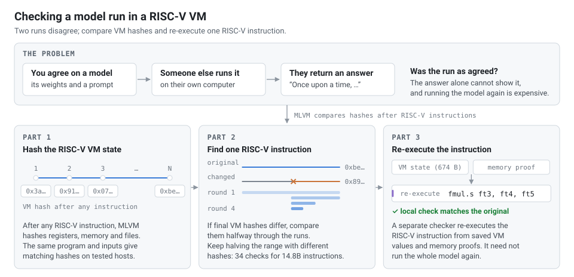
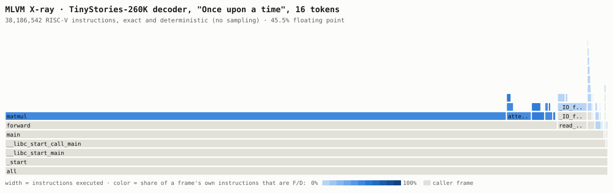
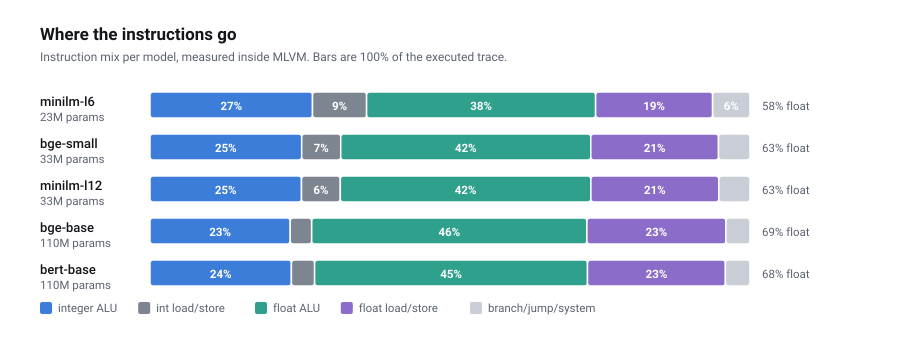
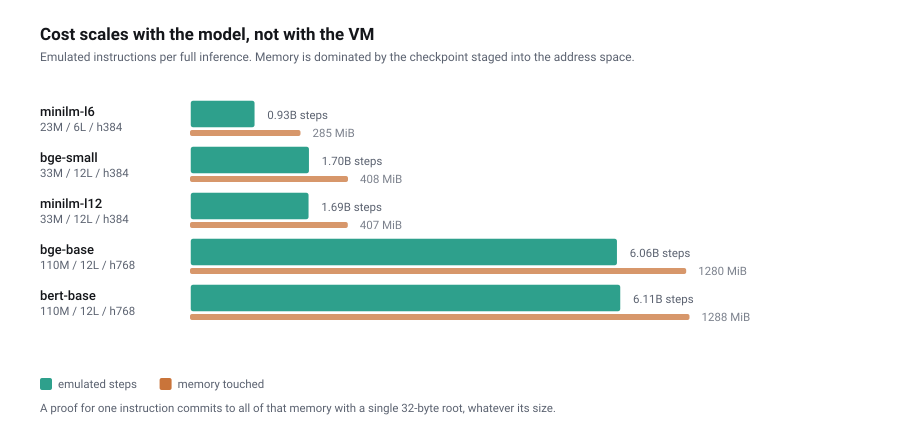
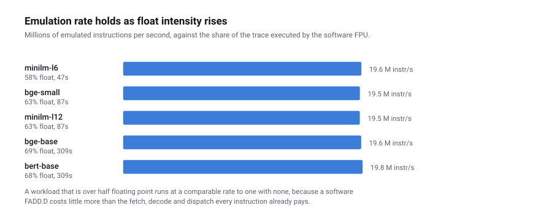

<div align="center">


# MLVM

**Verifiable model execution, one instruction at a time.**<br>
Every state of the run has a 32-byte fingerprint, so any disagreement comes down to a single instruction that anyone can check.

[](https://github.com/yao-jz/mlvm/actions/workflows/determinism.yml)
[](https://github.com/yao-jz/mlvm/actions/workflows/ci.yml)
[](https://github.com/yao-jz/mlvm/releases)
[](go.mod)
[](docs/ISA.md)
[](LICENSE)

[**Playground**](https://yao-jz.github.io/mlvm/) · [**How it works**](https://yao-jz.github.io/mlvm/blog.html) · [Docs](docs/README.md) · [Releases](https://github.com/yao-jz/mlvm/releases)

</div>

<p align="center">
  
</p>

MLVM is an RV64IMAFD virtual machine in Go. It executes every instruction in software,
floating point included, so the same program and inputs reach the same state root on every
host. When two runs disagree, bisection over their state hashes finds the first instruction
they disagree on, and a referee checks that one instruction instead of the whole run.

## Quick start

```bash
brew install yao-jz/tap/mlvm

mlvm demo "Once upon a time"   # TinyStories-260K inside the VM: 38,186,542 instructions, one root
mlvm liar                      # a second machine lies once; 26 questions find the instruction
mlvm xray --svg flame.svg      # where every instruction went, counted exactly
```

<details>
<summary>Other ways to install</summary>

```bash
curl -fsSL https://raw.githubusercontent.com/yao-jz/mlvm/main/install.sh | sh   # Linux, macOS
git clone https://github.com/yao-jz/mlvm && cd mlvm && make build                # Go 1.23+
```

Windows: the zip on the [releases page](https://github.com/yao-jz/mlvm/releases). The model,
tokenizer and guest the demos use are embedded in the binary.
</details>

## How it works

- **Software IEEE-754.** F and D instructions run through a Go port of Berkeley SoftFloat 3e.
  Rounding modes, NaN boxing and `fcsr` flags are machine state; the host FPU is never used.
- **One root.** A 674-byte witness holds the registers, float state and PC, the root of a
  sparse Merkle tree over 2⁶⁴ bytes of memory, and a root over staged files and descriptors.
- **Bisection.** Both parties answer "what is your hash after *n* steps?" from copy-on-write
  checkpoints. About log₂ N questions: 34 for 14.8 billion instructions.
- **One-step referee.** `RISCV.sol` in an in-process EVM, or its Go mirror `slow.Step`, for
  integer and memory steps; SoftFloat re-execution for float arithmetic.
- **Portable records.** A finished dispute is a few kilobytes of JSON. `mlvm referee` and the
  playground rule on it again without running either machine.

<p align="center">
  
</p>
<p align="center"><sub>23 recorded disputes over 13 programs, from small C programs to SmolLM2-135M through Candle. Each one ended on the instruction that was changed.</sub></p>

<p align="center">
  
</p>

## Bring your own model

A model is a program to MLVM. Anything that builds as a static RV64IMAFD Linux binary runs:
C or C++ through GCC, or Rust through [Candle](https://github.com/huggingface/candle). The
repository runs TinyStories (in C and in Candle), five BERT-family encoders and SmolLM2-135M
this way.

```bash
# 1. Build: static, no compressed instructions, no FP contraction
riscv64-unknown-linux-gnu-gcc -O2 -static -march=rv64imafd -mabi=lp64d -ffp-contract=off -o model model.c -lm
#    Rust + Candle: nightly, an RV64IMAFD target spec and build-std (see examples/rust)
cargo +nightly build --release --target riscv64imafd-unknown-linux-gnu.json -Zbuild-std=std,panic_abort

# 2. Stage the weights into guest memory, then profile the run or dispute it
mlvm xray --elf ./model --load-file model.safetensors=weights/model.safetensors --svg flame.svg
mlvm liar --elf ./model --load-file model.safetensors=weights/model.safetensors
```

- **Inputs** are files staged into guest memory. `--load-file guestPath=hostPath` gives each
  one a fixed name, so the weights and the prompt are part of the starting fingerprint.
  `--random-file` serves `getrandom` from a fixed blob.
- **The answer** goes into a 64-byte window at `MLVM_OUT`, with up to 48 bytes of payload:
  `mlvm_commit_result` in [`examples/mlvm_result.h`](examples/mlvm_result.h), or the Rust
  version in [`llm-candle`](examples/rust/llm-candle/src/main.rs). Printed output is not
  part of the state; the committed answer is.
- **Limits:** one thread, no compressed (`C`) instructions, and the system calls listed in
  [docs/SYSCALLS.md](docs/SYSCALLS.md).

Walkthroughs: [your own C program](docs/EXAMPLES.md#7-running-your-own-program) ·
[Candle guests](examples/rust/README.md) · [SmolLM2-135M](examples/rust/llm-candle/README.md).

## Profiles, exactly

A deterministic machine can count instead of sample. `mlvm xray` attributes every instruction
to its function and call stack, with the same counts on every computer, and writes flame graphs
colored by floating-point share. `--elf` profiles any static RV64IMAFD binary.

<p align="center">
  
</p>

<details>
<summary>Measurements on BERT-family models</summary>

<p align="center">
  
  
  
</p>

Methodology and raw rows: [docs/BENCHMARKS.md](docs/BENCHMARKS.md), [results/](results/).
</details>

## Layout

```text
cmd/mlvm        the CLI: demo, liar, referee, xray, run, witness, ...
rvgo/fast       interpreter, Merkle memory, witness, staged files
rvgo/comp       Berkeley SoftFloat 3e in Go
rvgo/slow       the state oracle that mirrors RISCV.sol
rvgo/internal   dispute, profiler, disassembler, EVM stepper
rvgo/wasm       the WebAssembly build behind the playground
rvsol           RISCV.sol and experimental contracts (Foundry)
examples        C and Rust guests: TinyStories, Candle BERT, SmolLM2
web             the playground and the write-up
spec            mlvm-1 format specifications
```

## Status

Pre-1.0 research software. It has not been audited, and formats may change between minor
versions.

- **Tested in CI:** the RV64IMAFD interpreter (23/23 float and 84 integer conformance suites);
  identical roots on Linux, macOS, Windows and WebAssembly; the committed state and witness;
  `demo`, `liar`, `referee` and `xray`.
- **Experimental:** the slow interpreter and EVM stepper, whose syscall surface still differs;
  the nested `f64` sub-game, round-to-nearest-even only; `MLClaim.sol`.
- **Not implemented:** an on-chain dispute game, with bonds, clocks and a deployment.

Component by component: [docs/STATUS.md](docs/STATUS.md).

## Development

```bash
make check      # gofmt, vet, links and Go tests: the gate for a pull request
make test-all   # adds Solidity, slow-mode and EVM cross-checks (needs Foundry)
make web        # the playground, in web/dist
```

Read [CONTRIBUTING](.github/CONTRIBUTING.md) before changing VM semantics. Report
vulnerabilities as described in [SECURITY](.github/SECURITY.md).

## Citation

```bibtex
@software{yao_mlvm,
  author = {Yao, Jianzhu and Viswanath, Pramod},
  title  = {{MLVM}: deterministic {RV64IMAFD} execution over committed memory},
  url    = {https://github.com/yao-jz/mlvm},
  year   = {2026}
}
```

## License

MIT. The VM derives from [Asterisc](https://github.com/ethereum-optimism/asterisc) (MIT),
floating point is a Go port of [Berkeley SoftFloat 3e](http://www.jhauser.us/arithmetic/SoftFloat.html)
(BSD), and the TinyStories-260K weights come from [llama2.c](https://github.com/karpathy/llama2.c)
(MIT). See [LICENSE](LICENSE).
