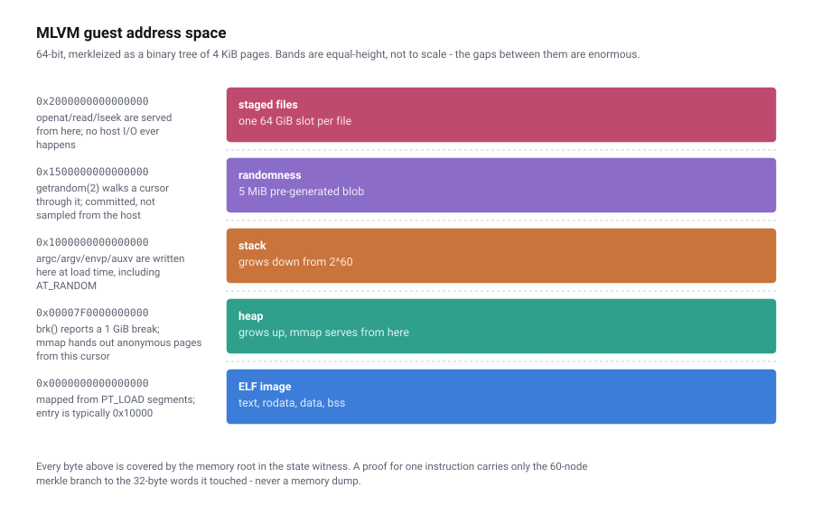

# Architecture

MLVM is a deterministic execution substrate and a laboratory for the terminal components
of an optimistic verification system. It executes RV64IMAFD programs over committed memory,
generates single-step witnesses, and cross-checks supported transitions against independent
Go and EVM implementations.

A complete system could add trace commitments, interactive bisection, bonds, timeouts, and
claim rules around those components. That outer protocol is not implemented here. The
diagram and sections below distinguish existing code from that intended integration.

---

## Contents

- [The shape of the system](#the-shape-of-the-system)
- [The VM state](#the-vm-state)
- [Memory: 2^64 bytes as a merkle tree](#memory-264-bytes-as-a-merkle-tree)
- [One step](#one-step)
- [Proof generation](#proof-generation)
- [Three VMs, one semantics](#three-vms-one-semantics)
- [Determinism: the hard part](#determinism-the-hard-part)
- [The OS surface](#the-os-surface)
- [Repository map](#repository-map)

---

## The shape of the system

<p align="center">
  
</p>

The implemented CPU single-step boundary is a 674-byte state witness plus one or two
1,920-byte Merkle branches. Bounded staged-file operations may carry more memory branches:
up to ten total for an unaligned 255-byte `openat` pathname and five for a 32-byte `read`.
They also append a fixed 992-byte metadata proof, verified by slow Go and `RISCV.sol`.
Whether and when a chain executes any step is a decision for the missing outer protocol.

---

## The VM state

Everything the machine can observe lives in a single struct
([`rvgo/fast/state.go`](../rvgo/fast/state.go)):

```go
type VMState struct {
    Memory          *Memory      // 2^64 addressable bytes, merkleized
    PC              uint64
    Registers       [32]uint64   // x0..x31
    FRegisters      [32]uint64   // f0..f31
    Heap            uint64       // mmap cursor
    LoadReservation uint64       // for LR/SC
    Step            uint64
    ExitCode        uint8
    Exited          bool
    PreimageKey     [32]byte     // oracle channel
    PreimageOffset  uint64
    RandomFileAddr  uint64       // getrandom(2) cursor
    RandomFileOffset uint64
    FCSR            uint64       // fflags [4:0] and frm [7:5]
    FileSystem      *FileSystem  // authenticated root is committed
    FilePointer     uint64       // included in the file-system root
}
```

`EncodeWitness()` flattens the committed state into **674 bytes**, big-endian:

| Offset | Size | Field |
| ---: | ---: | --- |
| 0 | 32 | memory merkle root |
| 32 | 32 | pre-image key |
| 64 | 8 | pre-image offset |
| 72 | 8 | PC |
| 80 | 1 | exit code |
| 81 | 1 | exited |
| 82 | 8 | step |
| 90 | 8 | heap |
| 98 | 8 | load reservation |
| 106 | 256 | `x0..x31` |
| 362 | 256 | `f0..f31` |
| 618 | 8 | randomness base address |
| 626 | 8 | randomness cursor |
| 634 | 8 | `fcsr` — IEEE-754 exception flags and rounding mode |
| 642 | 32 | authenticated staged-file and descriptor root |

Hashing that gives the state commitment, with one twist: the **first byte of the hash is
overwritten with a status code** (`0` valid, `1` invalid, `2` panic, `3` unfinished), so
the dispute contracts can read the outcome without decoding anything.

File **contents** live in merkleized memory. The final 32-byte field separately binds two
fixed-depth Merkle trees: an immutable file index sorted by raw name bytes and a descriptor
tree indexed directly by fd. Integers are unsigned 64-bit big-endian values:

```
fileID        = keccak256(path bytes)
fileLeaf      = keccak256("MLVM-FILE-V2\0" || fileID || size || address)
descriptor    = keccak256("MLVM-FD-V2\0" || fileID || offset)
filesystemRoot = keccak256(
    "MLVM-FILESYSTEM-V2\0" || filePointer || nextFd || fileCount
    || fileTreeRoot || descriptorTreeRoot
)
```

Each tree has 1,024 leaves and depth 10. A 31-word proof discloses the five-word header,
one file leaf with ten siblings, and one descriptor leaf with ten siblings. This lets
`openat`, staged `read`, `fcntl`, `lseek`, and `close` authenticate and update metadata in
constant proof size. Snapshots serialize the full reconstruction data as
`fileSystem.version: 2`; unsupported versions fail during decoding. The top-level snapshot
independently carries `schemaVersion: 3` (version 2 snapshots remain readable), which `run`
and `witness` validate before use. See [STATE-SCHEMA.md](STATE-SCHEMA.md) for the field and
migration policy.

The 992-byte trailer uses this word layout; the syscall supplies the descriptor-tree index
out of band, so the same bytes cannot select another fd:

| Words | Meaning |
| ---: | --- |
| 0-4 | `filePointer`, `nextFd`, `fileCount`, file root, descriptor root |
| 5-8 | file index, file ID, size, address |
| 9-18 | ten file-tree siblings, leaf upward |
| 19-20 | descriptor file ID and offset |
| 21-30 | ten descriptor-tree siblings, leaf upward |

---

## Memory: 2^64 bytes as a merkle tree



The guest gets a full 64-bit address space, but the VM only ever allocates the 4 KiB pages
it actually touches. A glibc "hello world" touches ~240 of them (960 KiB) out of 2^52
possible pages.

The tree is a fixed-depth binary merkle tree over the whole space:

```
                      memory root
                     /           \
                   ...           ...          52 levels of page index
                   /
              page (4 KiB)
             /            \
           ...            ...                 7 levels inside the page
           /
      32-byte leaf
```

- **52 levels** address the page (`64 - 12` bits of page index)
- **7 levels** address the 32-byte leaf inside a 4 KiB page (`4096 / 32 = 128`)
- **60 levels** total in a proof — hence the 1920-byte (60 × 32) merkle branch

Two optimisations make this practical, both in
[`rvgo/fast/memory.go`](../rvgo/fast/memory.go):

**Zero subtrees are free.** `zeroHashes[i]` precomputes the root of an all-zero subtree at
every level, so an unallocated region costs one array lookup instead of 2^52 hashes.

**Nodes are cached and invalidated lazily.** Writing to an address sets `nodes[gindex] =
nil` up the path to the root. Nothing is re-hashed until someone asks for the root, and
then only the dirty path is recomputed. In practice a full re-merkleization of a ~1 MiB
working set costs about 31 µs; a single proof against a warm cache costs about 7 µs.

---

## One step

`riscvStep()` in [`rvgo/fast/vm.go`](../rvgo/fast/vm.go) is the whole CPU. It is
one function, deliberately: it has to be mirrored line-for-line in Yul, and a function
that can be read top to bottom is a function that can be mirrored.

```
fetch      loadMem(PC, 4)                  -> raw 32-bit instruction
decode     parseOpcode / parseFunct3 / parseFunct7 / parseRs1 / ...
dispatch   switch(opcode) { 0x03 load, 0x23 store, 0x33 ALU, 0x53 float, 0x73 system, ... }
execute    64-bit ALU ops from yul64.go, floats from comp/ (SoftFloat)
commit     setRegister / setFRegister / setMemory / setPC
```

Everything is expressed in terms of a small vocabulary — `add64`, `shr64`, `signExtend64`,
`b32asBEWord` — defined twice: once over Go `uint64`
([`fast/yul64.go`](../rvgo/fast/yul64.go)) and once over 256-bit words
([`slow/yul256.go`](../rvgo/slow/yul256.go)). Same algebra, two carriers. That is
what lets the same instruction semantics run natively, over a state oracle, and inside the
EVM.

The opcode dispatch also maintains a lightweight profile (`OpCount`) that `mlvm run`
prints at exit:

```
=== instruction profile =========================
  steps                  285656
  integer ALU            153919 ( 53.9%)
  memory load/store       49887 ( 17.5%)
  float ALU                7790 (  2.7%)
  float load/store         6219 (  2.2%)
  pages touched            1526  (6.0 MiB)
  throughput              21.38 Minstr/s
=================================================
```

---

## Proof generation

`InstrumentedState.Step(proof bool)` wraps the CPU
([`rvgo/fast/instrumented.go`](../rvgo/fast/instrumented.go)). With `proof=false`
it just runs. With `proof=true` it records, for every 32-byte word the instruction touched,
the merkle branch proving that word's value against the pre-state root.

The bookkeeping is strict on purpose:

- `trackMemAccess(addr, i)` panics unless `i == len(memProofs)` — proofs must be appended
  in the exact order the on-chain verifier will consume them
- `verifyMemChange(addr, i)` panics unless the write targets the address that proof `i`
  covered — you cannot write to memory you did not first prove

That strictness is what makes the Go and Yul implementations trustworthy mirrors: if the
Go side ever produces proofs in a different order than the contract expects, it fails
loudly in Go rather than silently on chain.

The output of a proven step:

```
state witness   674 bytes    the full pre-state, hashable to the pre-state commitment
memory proof   1920 bytes    60 keccak nodes = one merkle branch
              (3840 bytes    when the access crosses a 32-byte boundary: two branches)
metadata proof  992 bytes    fixed trailer for a staged-file syscall
```

The metadata trailer is absent for ordinary instructions. `openat` records every pathname
leaf, while staged-file `read` records the file source and guest destination leaves. These
bounded syscall witnesses contain up to ten and five memory branches respectively, plus
the fixed trailer; fast, slow, and embedded-EVM tests compare their complete post-state.

Run it yourself:

```bash
make proof         # ./scripts/fraud-proof-demo.sh
```

which loads a program, runs it to completion, selects the middle of the trace, writes replay
checkpoints, emits the proof for that one step, and flips one register bit to show the
commitment change. It is a local witness demonstration, not an interactive game.

---

## Three VMs, one semantics

The same instruction set is implemented three times, at three levels of cost.

| | `rvgo/fast` | `rvgo/slow` | `rvsol/src/RISCV.sol` |
| --- | --- | --- | --- |
| **Carrier** | Go `uint64` on a real state | Go `uint256` on a state oracle | Yul `uint256` in the EVM |
| **Speed** | ~25M instr/s | ~thousands/s | one step, ~84K gas |
| **Purpose** | run and profile workloads | independent state oracle | execute a supported terminal step |
| **Executes F/D** | yes | loads/stores, sign injection and moves only; arithmetic reverts | loads/stores, sign injection and moves only; arithmetic reverts |
| **Syscalls** | 37 numbers recognised | a smaller subset | a different smaller subset |

`TestSlowStep` and `TestEVMStep` assert that all three produce the *same* post-state hash
for the supported conformance transitions. The syscall subsets are listed in
[SYSCALLS.md](SYSCALLS.md#coverage-outside-the-fast-vm); `getrandom` and several start-up
stubs differ, so no complete glibc or Rust `std` trace replays end to end in the slow VM or
`RISCV.sol` today. They run as part of `make test-all`; the faster
`make test` target exercises the fast interpreter only.

### Current status

**Integer transitions cross-check through all three.** For every one of the 84 integer,
multiply and atomic conformance suites, the fast VM, the slow VM and `RISCV.sol` executing
in an embedded EVM produce the same post-state hash, step for step. The observed EVM cost is
**~84,000 gas for an average step** (the original measurement; the current test prints only
per-suite maxima) **and 186,089 for the worst** transition in those suites (re-measured
2026-10-16 with `MLVM_RUN_EVM=1 go test ./rvgo/test/ -run TestEVMStep -v`).

```bash
make test-all    # builds contracts, then runs fast, slow and EVM cross-checks
```

Getting there took two changes. Adding RV64F/D first grew the state witness from 362 to 634
bytes (32 float registers plus the randomness cursor), and adding `fcsr` later grew it to
642 bytes. The file-system metadata digest now makes the current layout 674 bytes. Both
mirrors parse the current layout:

1. **The state layout**, in `slow/vm.go` and in `RISCV.sol`'s Yul. Mechanical — the float
   registers are carried in the witness, and the mirrors execute only the float
   instructions that move bits (loads, stores, sign injection, register moves). Float
   arithmetic reverts there rather than passing through.
2. **A hardcoded constant.** `RISCV.sol` computed the expected calldata offset of the proof
   as the literal `548`, with a comment deriving it from the old 362-byte state. It is now
   derived from `stateSize()` so it cannot drift again. Until that was found, every proof
   was rejected before a single instruction executed.

### Experimental nested f64 terminal route

`RISCV.sol` carries the float registers but does not *execute* F or D instructions. Closing
that by porting SoftFloat to Yul would mean several thousand lines of branchy, consensus
critical bit manipulation plus an audit.

The current prototype instead explores **nesting**: the same operation compiled for a target
without float instructions becomes integer soft-float code, whose individual transitions
`RISCV.sol` can execute. The boundary contract derives a canonical nested RISC-V machine
from supplied operands and reads the value and exception flags from its final state.

`make float-dispute` exercises these components against a disputed `FMUL.D` from the C MLP.
It measures nested-state derivation, one terminal integer step, and result readback. The
printed gas total is **not** a total dispute cost: it excludes bisection transactions,
calldata, bonds/timeouts, and the missing outer-to-inner binding contract.

Nested trace length varies by operation and compiler output rather than being a protocol
constant: means of 83–680 steps per operation in the current co-processor build, so one extra
bisection level of 7–10 rounds.

**Rounding-mode limit.** The nested machine always computes in round-to-nearest-even. The
decoder that maps an outer instruction to a sub-game operation (`DecodeFloatSubGame`) does
not read the instruction's `rm` field or `frm`, and the co-processor ABI has no rounding-mode
input; `BindFloatInstruction` records the mode, but nothing consumes it. A `D` instruction
that rounds in any other mode — a static `rtz`, `rdn`, `rup` or `rmm`, or a dynamic `rm`
with a non-zero `frm` — would be settled to a different result than the VM computed. Only
RNE `f64` transitions are within this component's scope. Even the C MLP contains such
instructions: glibc's `expm1` executes `fcvt.w.d ..., rtz` 24 times, and for 13 of them the
RNE result differs from the VM's.

An integer-only guest would avoid the float sub-game. MLVM does not currently ship or
evaluate a quantized model, so this remains a design option rather than a measured result.

---

## Claiming an inference

A future dispute protocol could establish *"this machine went from state A to state B"*.
The components above do not establish that claim today. A separate question is how a
proposed state B identifies the guest's answer.

Printing the answer does not close the gap. A guest's stdout is not part of the state
commitment, so a dishonest party can print whatever it likes and the chain has no way to
tell — it would settle the execution perfectly and still learn nothing about the result.

So the guest writes its answer into **its own memory**, at a fixed absolute address
(`examples/mlvm_result.h`). The final memory root then commits to it, and `MLClaim.sol` reads
it back with a single merkle branch — the same trick `FloatSubGame.sol` uses to read a float
result out of a nested machine, one level up:

```
0x3100000000000000  +0   magic "MLVM_OUT"   +8  length     <- leaf,     proof[0]
                    +16  payload[0..16]
                    +32  payload[16..48]                   <- sibling,  proof[1]
```

The window is 64 bytes and 64-byte aligned, so its two 32-byte leaves are siblings and one
branch carries both. A claim becomes three things:

| | |
| --- | --- |
| `preState` | commits the ELF, staged bytes, randomness memory, and staged-file metadata digest; it can be recomputed with `bin/mlvm ml-claim --prestate` |
| `postState` | a proposed halted state that a future outer protocol would need to establish |
| `answer` | read *out of* `postState`, never taken on trust |

and `claimId = keccak(preState, postState, keccak(answer))` binds them into one word.

The property this component establishes is narrower: **the answer cannot be changed without
changing this post-state hash**, because it lives inside the memory the root covers.
`make ml-claim` demonstrates that commitment and contract readback.

Only guests that call `mlvm_commit_result` get this property. In this repository that is
`examples/mlp.c` and the TinyStories decoder (`examples/decoder`). The Rust BERT guest only
prints its score to stdout, so its answers are not bound to any post-state.

### What this does not do

It does not settle a dispute. That needs a game contract and a challenger, neither of which
is here. `RISCV.sol.step()` matches op-stack's `IBigStepper` interface signature and
`mlvm run` exposes `--proof-at`, `--snapshot-at`, and `--stop-at`, but integration still has
to bind the outer instruction and operands to the nested prestate and apply the nested result
to the required outer post-state. That is protocol work, not merely deployment wiring.

For scale, a 6.1-billion-step BERT run would require roughly 33 binary-search levels in a
simple future game, potentially with an on-chain transaction and challenge window at each
level. That is a protocol cost projection, not implemented behavior.

---

## Determinism: the hard part

A fraud proof is only meaningful if honest parties agree. Every source of nondeterminism
has to be closed, and the interesting ones are not obvious.

**Floating point.** Hardware FPUs differ in fused multiply-add contraction, subnormal
flushing and NaN payloads. MLVM never touches the host FPU: `rvgo/comp` is a Go port of
[Berkeley SoftFloat 3](http://www.jhauser.us/arithmetic/SoftFloat.html) — 121 files, ~5,800
lines — executing every F and D instruction in the rounding mode the instruction selects
(round-to-nearest-even unless the program asks otherwise) and with a fixed NaN policy. See
[ISA.md](ISA.md#how).

The result is verifiable. `make determinism` compiles the same C to RV64 and to your host,
runs one in the VM and one natively, and diffs:

```
=== ieee ===============================================
IDENTICAL - MLVM softfloat == host FPU, byte for byte
    sum       = 3.8956542839085366
    product   = -0.82400427912558161
    sqrt(sum) = 1.9737411896975086
    subnormal = 5.5626846462679985e-309
    underflow = 2.1849137534174492e-08
```

Bit-exact through about 16,000 dependent operations including gradual underflow. See
[BENCHMARKS.md § Floating-point determinism](BENCHMARKS.md#floating-point-determinism) for
the two cases where output still diverges and why neither is an emulator bug.

**Randomness.** `getrandom(2)` cannot call the host RNG — two parties would observe
different bytes and disagree about a state neither got wrong. Instead a 5 MiB window at
`0x1500_0000_0000_0000` is part of the committed initial state. It is sparse and zero-filled
by default, or populated from an explicit deterministic blob. `getrandom` walks a cursor
through it, and the cursor is in the witness. That is the fast VM; the slow interpreter
reverts on `getrandom` and `RISCV.sol` treats it as a no-op, so these transitions are
committed but not yet checkable (see [SYSCALLS.md](SYSCALLS.md#randomness)).

**Time.** `clock_gettime` returns a hardcoded 1337s + 42ns.

**Concurrency.** There is none. `clone` returns 1 and `clone3` returns -1 without creating a
thread, `futex` is a no-op, `sched_yield` returns immediately. One hart, one thread, no
scheduler — so no interleaving to disagree about.

**Host introspection.** Anything under `/proc`, `/sys`, `/dev` or `/run` is refused with
`EACCES`. Both glibc and the Go runtime probe a long tail of these for hugepage sizes, CPU
topology and cgroup limits; letting any of it through would make the trace depend on the
machine that produced it.

---

## The OS surface

There is no kernel. `ECALL` is dispatched by a switch on `a7` that recognises **37 Linux
syscall numbers** (35 answered, 2 refused) — enough for static glibc and Rust `std` to start,
allocate, read files and print. Details, the full table, and the smaller slow/`RISCV.sol`
subsets are in [SYSCALLS.md](SYSCALLS.md).

Files deserve a note here because they are how a model gets in. There is no block device
and no host I/O at runtime. Files are staged into the address space at load time, each at
a 64 GiB-aligned slot from `0x2000_0000_0000_0000`, and `openat`/`read`/`lseek` are served
straight out of merkleized memory. The file bytes are covered by the memory root, while a
separate authenticated root binds the manifest and descriptor cursors. Fixed proofs make
the bounded file transitions checkable by both verifier implementations.

---

## Repository map

```
mlvm/
├── asterisc/                 the virtual machine (fork of ethereum-optimism/asterisc)
│   ├── cmd/mlvm/             the `mlvm` CLI entry point
│   ├── rvgo/
│   │   ├── fast/             the VM: vm.go is the CPU, memory.go the merkle tree
│   │   ├── slow/             state-oracle mirror of RISCV.sol
│   │   ├── comp/             Berkeley SoftFloat 3, ported to Go   (121 files, 5.8k lines)
│   │   ├── include/          SoftFloat support types and rounding modes
│   │   ├── riscv/            RISC-V-specific NaN specialisation
│   │   ├── cmd/              CLI command implementations: load-elf, run, witness
│   │   └── test/             conformance, benchmarks, tamper detection
│   ├── rvsol/src/RISCV.sol   the integer CPU in Yul, ~2,000 lines
│   ├── rvsol/lib/            submodules: forge-std, optimism
│   └── tests/riscv-tests/    compiled riscv-tests vectors (integer, mul, atomics, F/D)
│
├── examples/                 everything you can run -> examples/README.md
│   ├── *.c                   five C guests: hello, ieee, matmul, mlp, fileio
│   ├── decoder/              TinyStories Llama2-C decoder guest
│   ├── data/                 files staged into emulated memory
│   └── rust/                 Rust guests -> examples/rust/README.md
│       ├── bert-riscv/       Candle BERT-family encoders, RV64IMAFD target spec
│       ├── bert-host/        the same source, built for the host
│       ├── candle-reference/ native candle reference harness
│       ├── float-placement/  one no_std GEMM built for rv64imafd and rv64ima
│       ├── float-coprocessor/ RV64IMA nested f64 machine for the experimental sub-game
│       └── playground/       RV64IMA probes (no F/D: compiler-level soft float)
│
├── docs/                     you are here, plus fig/ for the diagrams
├── scripts/                  run-elf, determinism, fraud-proof demo, bench, ISA coverage
└── third_party/              submodules: candle, MLinRust
```

### Where the work is

`asterisc` is a fork. The VM core, the merkle memory, the bisection tooling and the
Solidity mirror are upstream work by
[@protolambda](https://github.com/protolambda) and Optimism. What this project added:

| Area | Change |
| --- | --- |
| **RV32/64 F and D** | ~880 lines in `fast/vm.go` decoding 62 float instructions |
| **SoftFloat** | `comp/`, `include/`, `riscv/` — about 6,100 lines of ported Berkeley SoftFloat |
| **In-memory filesystem** | `fast/file.go` + `openat`/`read`/`lseek`/`close`/`statx` |
| **Deterministic randomness** | committed blob + cursor, `getrandom(2)` |
| **C/C++ syscall surface** | the syscalls glibc needs that the Go runtime did not |
| **Instruction profiling** | `OpCount`, reported per run |

Upstream asterisc explicitly declines floating point: *"no IEEE754 determinism with
rounding modes etc., nor worth the complexity"*. Doing it anyway is what makes this a
machine-learning VM rather than a general one.

How complete is it? **All 23 applicable RV64 F/D conformance suites pass**, up from 9 —
the fourteen failures were the unimplemented exception flags and rounding modes (eleven of
them), `FMIN`/`FMAX` NaN selection, and NaN-boxing. Independently of the suites, the
arithmetic agrees with a native FPU bit-for-bit on 200,000 random operand pairs each for
`+ − × ÷` and 160,049 for `√`. See [ISA.md](ISA.md#conformance) for the breakdown.

---

## Further reading

- [ISA.md](ISA.md) — instruction-level coverage and the known semantic gaps
- [SYSCALLS.md](SYSCALLS.md) — the OS surface, memory map, filesystem
- [STATE-SCHEMA.md](STATE-SCHEMA.md) — JSON snapshots, witness compatibility, version policy
- [BENCHMARKS.md](BENCHMARKS.md) — measured throughput, witness sizes, determinism results
- [EXAMPLES.md](EXAMPLES.md) — guided walkthroughs
