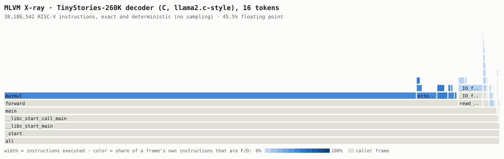
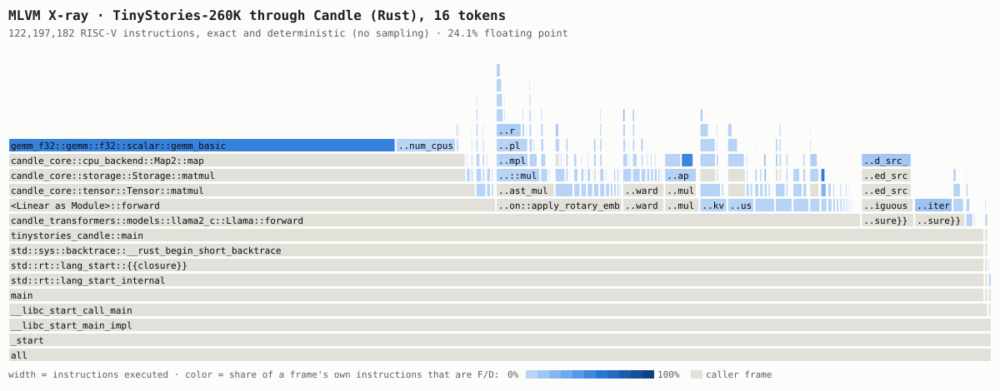
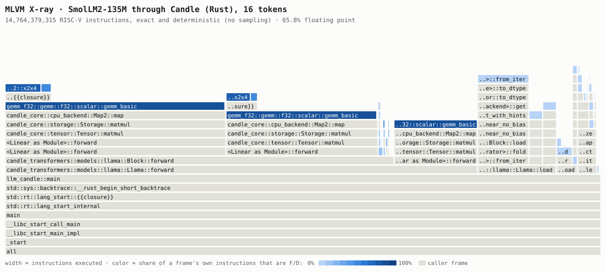
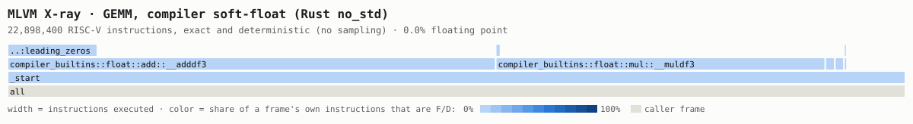
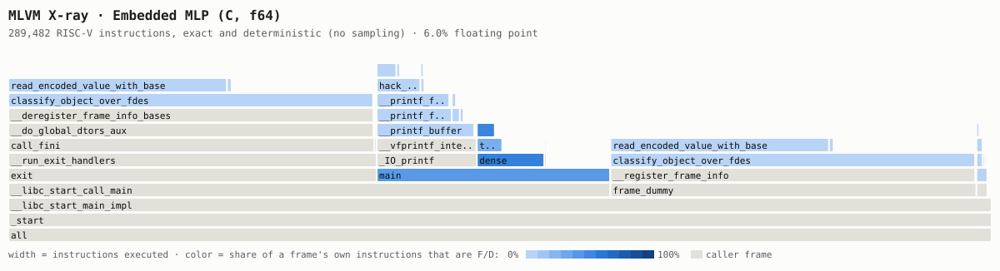
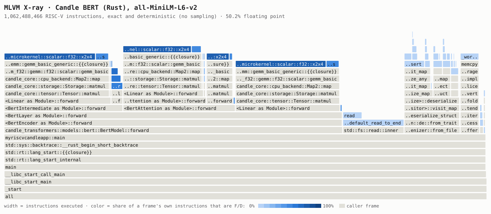

# Gallery

MLVM's two tools work on any RV64IMAFD program, not only the embedded TinyStories model.
This page runs both on thirteen: C programs of a few hundred thousand instructions, the same
language model implemented twice (in C and in Hugging Face's
[Candle](https://github.com/huggingface/candle)), a Hugging Face LLM, SmolLM2-135M, writing
text and code through Candle, one GEMM built with and without float instructions, and five
BERT checkpoints running through Candle. The longest run is SmolLM2's, 14.8 billion
instructions.

- **X-ray** (`mlvm xray`) attributes every executed instruction to its function and call
  stack. Counts are exact, not sampled, and the same on every machine.
- **Catch the Liar** (`mlvm liar`) runs the program on two machines, one of which lies
  once. A referee bisects on their state hashes until one instruction is left, then checks
  that instruction alone.

The lies, from subtle to blatant:

| `--lie` | The liar's machine… | Ruled by |
| --- | --- | --- |
| `ulp` | rounds one float result one unit in the last place the wrong way | SoftFloat, from the witness |
| `load` | reads one bit of one loaded weight wrong | `RISCV.sol` in an EVM, and `slow.Step` |
| `int` | flips the lowest bit of one integer result | `RISCV.sol`, `slow.Step` |
| `output` | prints different bytes than the honest machine | nothing to rule on (see [below](#printing-is-not-committing)) |
| `commit`, `token` | commits a different answer at `MLVM_OUT` | `RISCV.sol`, `slow.Step` |

Every number below comes from `scripts/gallery.sh`, run on an Apple M3 Max on 2026-10-20 and 21.
Rows are in [`results/gallery.tsv`](../results/gallery.tsv), full reports in
[`results/gallery/`](../results/gallery), flame graphs in [`gallery/`](gallery). Time is
CPU seconds (user plus system) for the whole command: both machines' runs, the lie, the
bisection and the verdict. Wall clock on a laptop depends on what else it is doing. Peak
memory is the maximum resident set size; macOS compresses memory under pressure, so runs
that shared the machine with others may read somewhat low.

Each dispute's report is also its record ([`mlvm.dispute-record/1`](../spec/dispute-record-v1.md)),
with the witness and Merkle proofs of the disputed instruction. `mlvm referee
results/gallery/smollm2-liar-token.json` rules on SmolLM2's again without the model or its
14.8 billion instructions, and the [playground](https://yao-jz.github.io/mlvm/#gallery)
replays every dispute below and referees its record in the browser.

## At a glance

| Program | Instructions | The lie | Questions | Caught at | Ruled by | CPU | Peak memory |
| --- | ---: | --- | ---: | --- | --- | ---: | ---: |
| TinyStories-260K (C) | 38,186,542 | float result off by 1 ULP | 26 | `fmadd.s` in `attention` | SoftFloat | 3.9 s | 58 MB |
|  |  | forged answer token | 25 | `sb` in `main` | RISCV.sol, 131,482 gas | 4.1 s | 57 MB |
| TinyStories-260K (Rust, Candle) | 122,197,182 | float result off by 1 ULP | 27 | `fcvt.s.d` in `CpuStorage::affine` | SoftFloat | 9.7 s | 99 MB |
|  |  | forged answer token | 27 | `sb` in `tinystories_candle::main` | RISCV.sol, 131,514 gas | 10 s | 101 MB |
| SmolLM2-135M (Rust, Candle) | 14,764,379,315 | float result off by 1 ULP | 34 | `fmul.s` in `gemm_f32::gemm::f32::scalar::gemm_basic` | SoftFloat | 2206 s | 10.2 GB |
|  |  | forged answer token | 34 | `sb` in `llm_candle::main` | RISCV.sol, 131,569 gas | 1511 s | 9.9 GB |
| MLP (C, f64) | 289,482 | float result off by 1 ULP | 18 | `fcvt.d.w` in `expm1` | SoftFloat | 0.2 s | 38 MB |
|  |  | one bit of a loaded value | 18 | `fld` in `expm1` | RISCV.sol, 83,675 gas | 0.2 s | 36 MB |
|  |  | one bit of an integer result | 19 | `addi` in `dense` | RISCV.sol, 47,888 gas | 0.4 s | 36 MB |
|  |  | forged printed result | 18 | `addi` in `write` | RISCV.sol, 47,921 gas | 0.2 s | 38 MB |
|  |  | forged committed answer | 19 | `sb` in `main` | RISCV.sol, 131,482 gas | 0.2 s | 37 MB |
| matmul (C, f64) | 486,505 | float result off by 1 ULP | 19 | `fcvt.d.w` in `main` | SoftFloat | 0.3 s | 37 MB |
|  |  | one bit of a loaded value | 19 | `fld` in `main` | RISCV.sol, 83,632 gas | 0.3 s | 35 MB |
| ieee (C, f64) | 263,030 | float result off by 1 ULP | 18 | `fsqrt.d` in `main` | SoftFloat | 0.2 s | 36 MB |
| GEMM, float instructions (Rust) | 903,446 | float result off by 1 ULP | 20 | `fmul.d` in `_start` | SoftFloat | 0.3 s | 32 MB |
| GEMM, soft-float (Rust) | 22,898,400 | one bit of an integer result | 25 | `mulhu` in `__muldf3` | RISCV.sol, 48,576 gas | 1.9 s | 33 MB |
| all-MiniLM-L6-v2 (Rust, Candle) | 1,062,488,466 | float result off by 1 ULP | 30 | `fadd.s` in `gemm_f32::microkernel` | SoftFloat | 100 s | 2.5 GB |
|  |  | one bit of a loaded value | 30 | `flw` in `gemm_common::pack_operands::pack_lhs` | RISCV.sol, 80,250 gas | 146 s | 2.4 GB |
|  |  | forged printed result | – | no dispute: same final state | – | 97 s | 2.5 GB |
|  |  | forged committed answer | 30 | `sb` in `myriscvcandleapp::main` | RISCV.sol, 131,492 gas | 103 s | 2.5 GB |
| all-MiniLM-L12-v2 | 1,889,889,048 | float result off by 1 ULP | 31 | `fadd.s` in `gemm_f32::microkernel` | SoftFloat | 250 s | 2.8 GB |
| bge-small-en-v1.5 | 1,896,458,947 | float result off by 1 ULP | 31 | `fadd.s` in `gemm_f32::microkernel` | SoftFloat | 173 s | 2.9 GB |
| bge-base-en-v1.5 | 6,705,827,787 | float result off by 1 ULP | 32 | `fmul.s` in `gemm_f32::microkernel` | SoftFloat | 628 s | 8.2 GB |
| bert-base-uncased | 6,752,543,098 | float result off by 1 ULP | 32 | `fadd.s` in `gemm_f32::microkernel` | SoftFloat | 618 s | 8.6 GB |

Every dispute ended on the instruction the liar changed, and the referee ruled for the
honest machine. The one run with nothing to dispute is explained
[below](#printing-is-not-committing).

---

## One model, two implementations

The embedded demo is a 260K-parameter TinyStories model in llama2.c-style C. The same
checkpoint, tokenizer and request also run through Candle:
[`examples/rust/tinystories-candle`](../examples/rust/tinystories-candle) loads the weights
into `candle-transformers`' `llama2_c::Llama` and generates greedily with its KV cache, with
llama2.c's tokenizer ported to Rust and the answer committed in the decoder's layout.

| Prompt | C decoder | Candle | Same 16 tokens |
| --- | ---: | ---: | --- |
| *Once upon a time* | 38,186,542 instructions | 122,197,182 instructions | yes |
| *The dragon* | 41,736,368 | 133,767,232 | yes |
| *Lily and Ben* | 38,115,752 | 122,338,820 | yes |

One implementation uses fused multiply-adds in hand-written loops, the other separate
multiplies and adds in a general tensor library's `gemm`; they round differently, and still
choose the same tokens.

<p align="center"></p>
<p align="center"></p>

**X-ray.** In C, `matmul` is 83.2% of the run and each generated token costs 1.77 million
instructions. Through Candle, a token costs 5.42 million: `gemm` is 41% of the run, and much
of the rest is the cost of a general tensor library on a tiny model, allocating, copying and
freeing small tensors. And 7.7% of all instructions, 9.5 million, are
`num_cpus::get_num_cpus`. Candle asks how many CPUs there are on every `matmul` unless
`RAYON_NUM_THREADS` is set, and inside the VM there is no environment. Setting it at
startup takes the run from 122,197,182 to 113,196,552 instructions with the same tokens. A
sampling profiler would show the same thing only approximately; here it is an exact count.

**1 ULP.** In C, the liar's first three lies were erased by later rounding, two within 20
instructions and one after 308,787; the fourth, an `fmadd.s` in `attention` (`22.0100174`
kept as `22.0100193`), survived. Through Candle, the lie that stuck is an `fcvt.s.d` in
Candle's `affine` operation, which converts its multiplier from f64 to f32 on every call: 1.0
kept as 1.00000012. Both liars still tell the same story; only the state roots differ. 26 and
27 questions.

**Forged token.** `--lie token --word Tim` makes the liar commit "named Tim" instead of "named
Lily". In both implementations bisection lands on the `sb` that stores the byte, in `main`
and in `tinystories_candle::main`, and `RISCV.sol` computes the honest result (131,482 and
131,514 gas). `mlvm liar` treats any guest that stages the TinyStories tokenizer like the
decoder, so the committed tokens of the Candle guest read as text.

## A Hugging Face LLM: SmolLM2-135M

[`examples/rust/llm-candle`](../examples/rust/llm-candle) loads
[SmolLM2-135M](https://huggingface.co/HuggingFaceTB/SmolLM2-135M) with `candle-transformers`'
`llama::Llama` and its own `tokenizer.json` through Hugging Face `tokenizers`, and
generates greedily with a KV cache: 30 layers, 135 million parameters, a 49,152-token
byte-level BPE vocabulary.

| Prompt | Generated (16 tokens) | Instructions | Same tokens as native Candle |
| --- | --- | ---: | --- |
| *Once upon a time* | ", there was a little girl named Lily. She lived in a big house with" | 14,764,379,315 | yes |
| *def fibonacci(n):* | `\n    if n == 0:\n        return 0\n    elif n == ` | 15,662,424,162 | yes |

"Native" is the same source built for macOS arm64, where Candle's `gemm` uses NEON and
several threads. Inside the VM it runs on one thread and MLVM's SoftFloat, and chooses the
same 16 tokens for both prompts.

<p align="center"></p>

**X-ray.** Loading the checkpoint and reading the prompt is 3.0 billion instructions, the
prompt's forward pass brings the first token at 5.1 billion, and each generated token after
that costs 640 million. `gemm` is 76% of the run. Most of the loading is not reading the
file but converting it: 13% of the run is `Tensor::to_dtype` turning bf16 weights into
f32, and the tied embedding matrix is converted twice, once as the embedding and once as
the output projection.

**1 ULP.** The liar's lie that stuck is an `fmul.s` in Candle's `gemm_basic`, halfway
through the run at instruction 7,382,193,173 (`0.00950023811` kept as `0.00950023718`).
Nine earlier lies were erased by rounding within 3 to 1,425 instructions, and one outlived
its lockstep window but vanished before the end, so the liar ran the program again. Both
machines print and commit the same 16 tokens; only the state roots differ. 34 questions
narrow 14,764,379,315 instructions to that `fmul.s`. With the liar's second run, the
dispute took 37 minutes of CPU and 10.2 GB at peak.

**Forged token.** `--lie token --token-index 7 --token-id 6362` makes the liar commit
" Tim" (6362) as the eighth token instead of " Lily" (14176). Its stdout still says Lily:
the lie is only in the committed answer, which is what the state root holds. The first
store of that token, 21 million instructions before the end, is where the machines part.
34 questions find it, the `sb` in `llm_candle::main`, and `RISCV.sol` computes the honest
result for 131,569 gas, as it does for both TinyStories guests above. 25 minutes of CPU and
9.9 GB at peak, on the first try.

## Floats as instructions, floats as integers

[`examples/rust/float-placement`](../examples/rust/float-placement) is one `no_std` GEMM
built twice: for RV64IMAFD, where MLVM executes `fmul.d` with SoftFloat, and for RV64IMA,
where the compiler expands every float operation into integer code (`__muldf3`,
`__adddf3`). Both print the same bits.

| Build | Instructions | Where they go | The lie | Questions | Ruled by |
| --- | ---: | --- | --- | ---: | --- |
| float instructions | 903,446 | one loop, 54.8% float | `fmul.d` result off by 1 ULP | 20 | SoftFloat |
| soft-float | 22,898,400 | `__adddf3` 44.4%, `__muldf3` 36.2% | low bit of the `mulhu` in `__muldf3` | 25 | `RISCV.sol`, 48,576 gas |

<p align="center"></p>

The same multiplication, lied about in each build. With float instructions the disputed
step is an `fmul.d`, which `RISCV.sol` cannot execute, so the verdict is a local SoftFloat
re-execution. In the soft-float build the multiplication is integer instructions, and the
disputed step is the `mulhu` that forms the high half of the mantissa product: `RISCV.sol`
settles it by itself. The price is 25 times the instructions to bisect over, which costs
five more questions. This is the trade-off behind MLVM's experimental float sub-game
([examples/rust/README.md](../examples/rust/README.md)).

Most lies in the float build vanish: in a dot product, a one-ULP change to one product is
usually absorbed by the rounding of the sum. The liar needed 153 tries.

## Small C programs

| Program | Instructions | What X-ray shows | Lies |
| --- | ---: | --- | --- |
| [MLP](../examples/mlp.c) (embedded `--demo mlp`) | 289,482 | 73% is libgcc sorting unwind tables at startup and exit; the network's `dense` is 4.3% | five, below |
| [matmul](../examples/matmul.c), 32×32 f64 | 486,505 | `main` 52.6%, unwind-table setup 43% | ULP, load |
| [ieee](../examples/ieee.c), IEEE-754 rounding regression | 263,030 | unwind-table setup 80%, `main` 8.5% | ULP in `fsqrt.d` |

<p align="center"></p>

The MLP gets five of the six kinds of lie:

- **1 ULP, f64.** Five tries; the fifth, `fcvt.d.w` in `expm1` (`-2` kept as
  `-2.0000000000000004`), survived. The printed checksum is unchanged, but the committed
  probabilities differ in one bit.
- **One bit of a loaded value.** One `fld` reads `-0.5` as `-0.50000000000000011`. A load is
  not arithmetic, so `RISCV.sol` rules (83,675 gas). The proof is 3,840 bytes: one Merkle
  branch for the instruction fetch, one for the loaded word.
- **One bit of an integer result**, inside `dense` (`--function dense`). The first four such
  lies crashed the program, so the liar moved on; the fifth, a register copy in `dense`,
  changes the checksum to `78.113304343060136`. `RISCV.sol` rules (47,888 gas).
- **Forged committed answer.** The MLP commits four probabilities and its argmax.
  `--lie commit --forge 0x0000000000000000=0x0300000000000000` makes the argmax 3: one
  forged `sb` in `main`, 131,482 gas.
- **Forged printed result**, `checksum = 97.66…` instead of `67.66…`. Bisection lands on the
  instruction before the `write(2)`, where the liar changed its buffer (47,921 gas). This
  one is disputable only because the buffer happens to survive until the program exits.

In matmul, one ULP above zero is the smallest subnormal: the lie turns a converted `0` into
`4.94e-324`. A misread `0.25` makes it print `C[31][31] = 120.50000000000001`. In ieee, a
square root one ULP short changes nothing that is printed.

## Candle BERT: all-MiniLM-L6-v2

[`examples/rust/bert-riscv`](../examples/rust/bert-riscv): a Rust program using
`candle-transformers`' `BertModel` to embed *"The cat sits outside"* and *"The cat plays in
the garden"* and print their cosine similarity, which it also commits at `MLVM_OUT`. It runs
on Rust `std` inside the VM and reads `config.json`, `tokenizer.json` and the 90 MB
`model.safetensors` from staged files.

<p align="center"></p>

**X-ray.** Rust symbols are demangled. `BertModel::forward` is 70.1% of 1,062,488,466
instructions, and one function, `gemm_f32::microkernel::scalar::f32::x2x4`, is 56.9%.
Reading the staged files is 12.8% (the VM serves file reads 32 bytes at a time) and
building the tokenizer from `tokenizer.json` 11.6%. Float arithmetic is 342.6 million
single-precision operations against 6.4 million double. Candle's per-`matmul` CPU count,
7.7% of the TinyStories run, is 0.05% here: these matrices are large.

**1 ULP.** Seven lies were erased by rounding within 3 to 364 instructions; the eighth,
`fadd.s` in the gemm microkernel (`0.102296554` kept as `0.102296546`), survived to the end.
Both machines print and commit `score: 0.6110916734`; only the state roots differ. 30
questions narrow 1,062,488,466 instructions to that `fadd.s`, and SoftFloat re-execution
from the 674-byte witness rules for the honest machine.

**One bit of a loaded value.** An `flw` in `gemm_common::pack_operands::pack_lhs`, which
copies a matrix operand into the layout the microkernel reads, brings in `0.119872235`
instead of `0.119872227`. Most such misreads are gone 397,422 instructions later, once the
packed buffer has been consumed and packed again, and the liar needed 13 tries. The one that
stuck reaches the answer: the liar commits `score: 0.6110918522`. `RISCV.sol` rules on the
`flw` (80,250 gas).

### Printing is not committing

The same forged score, two ways:

| | The liar prints | The liar commits | Final states | Dispute |
| --- | --- | --- | --- | --- |
| `--lie output --forge "score: 0.61=score: 0.91"` | `score: 0.9110916734` | `score: 0.6110916734` | identical | none: nothing to rule on |
| `--lie commit --forge "score: 0.61=score: 0.91"` | `score: 0.6110916734` | `score: 0.9110916734` | differ | 30 questions; an `sb` in `myriscvcandleapp::main`, `RISCV.sol` 131,492 gas |

The forged print changes bytes in Rust's stdout buffer right before the `write(2)` at
instruction 1,048,851,296. In the remaining 13.6 million instructions something overwrote
those bytes, and by the time the program exits, no trace of the forgery is left in the
state. The forged commit changes the byte the guest stores into `MLVM_OUT` (`6` becomes
`9`, at instruction 1,048,853,135), and that address keeps it until the end. The referee
lands on that store.

This is the rule the whole system rests on: **MLVM proves what the state commits, and
nothing else.** Stdout is not part of the state. The decoders commit their tokens and the
BERT guest commits its score so that a forged answer always leaves a trace.

## Four more checkpoints

The same program and the same ULP lie on larger checkpoints. `scripts/gallery.sh --all`.

| Checkpoint | Parameters | Instructions | Forward pass | gemm microkernel | X-ray CPU | Questions | Tries | Caught at | Committed score, honest → liar |
| --- | ---: | ---: | ---: | ---: | ---: | ---: | ---: | --- | --- |
| all-MiniLM-L6-v2 | 22.7M | 1,062,488,466 | 70.1% | 56.9% | 38 s | 30 | 8 | `fadd.s fa5,fa5,ft4` | `0.6110916734` → `0.6110916734` |
| all-MiniLM-L12-v2 | 33.4M | 1,889,889,048 | 78.8% | 64.0% | 67 s | 31 | 4 | `fadd.s ft1,ft1,ft5` | `0.6257025003` → `0.6257023215` |
| bge-small-en-v1.5 | 33.4M | 1,896,458,947 | 78.7% | 63.8% | 68 s | 31 | 16 | `fadd.s ft1,ft1,ft5` | `0.7658209205` → `0.7658210397` |
| bge-base-en-v1.5 | 109.5M | 6,705,827,787 | 85.2% | 71.6% | 231 s | 32 | 6 | `fmul.s ft5,ft6,ft7` | `0.7760061622` → `0.7760063410` |
| bert-base-uncased | 110.1M | 6,752,543,098 | 84.6% | 71.1% | 232 s | 32 | 1 | `fadd.s fa4,fa4,ft4` | `0.6334546804` → `0.6334547400` |

The larger the model, the more of the run is the forward pass and the less is loading; the
gemm microkernel's share grows from 57% to 72%. Float arithmetic is more than 98% single
precision in every checkpoint. The X-ray of a 6.75-billion-instruction run takes four
minutes of CPU and 3 GB.

Except on MiniLM-L6, the surviving lie reaches the committed score, in the seventh digit.
On MiniLM-L12 and bge-base it also changes how many instructions the run takes (16 fewer
and 68 more); that does not matter to the referee, since bisection runs to the longer of
the two traces. On MiniLM-L12 the first lie that outlived its lockstep window vanished
before the end, so the liar ran the program again, which is why that dispute took 250 CPU
seconds against bge-small's 173.

A dispute over a base-size checkpoint is the expensive case: both machines run 6.75
billion instructions and keep their checkpoints, about 10.5 minutes of CPU and 8.2 to 8.6 GB
at peak. On bert-base the liar's first lie stuck; on bge-small it took 16 tries.

## What the gallery shows

- **Questions grow with the logarithm of the run.** 18 questions for 263 thousand
  instructions, 26 for 38 million, 30 for a billion, 32 for 6.75 billion and 34 for 14.8
  billion. The referee's
  work does not depend on the program; the parties replay at most one checkpoint interval
  per question.
- **Rounding erases most small lies.** A one-ULP change is usually absorbed by the next
  rounding: the float GEMM's liar needed 153 tries, bge-small's 16 and MiniLM-L6's 8. The liar keeps a lie only
  after it has outlived a 2.5-million-instruction lockstep window, and starts over if it
  still vanishes, or crashes the program, before the end.
- **A surviving lie need not change the answer.** The two TinyStories implementations print
  the same story after their lies, and ieee prints the same digits. Comparing outputs would
  not catch them.
- **What is ruled where.** Integer instructions, loads and stores, float loads included,
  are checked by `RISCV.sol` itself in an EVM. Float arithmetic is checked by SoftFloat
  re-execution, locally: `RISCV.sol` does not implement it. Compiling floats to integer code
  moves a lie from the second kind to the first.
- **Only committed answers can be disputed.** A forged printed score leaves no trace; a
  forged committed one does.

## Running it

```bash
./scripts/gallery.sh                 # everything but SmolLM2 and the four larger BERTs
./scripts/gallery.sh --all           # plus those: about two hours of CPU, 10 GB at peak
./scripts/gallery.sh gemm-softfloat  # one entry
```

`decoder` and `mlp` need nothing but MLVM. The others need guests built outside Go, and are
skipped with a note when they are missing: the C examples (`make examples`), the Rust
crates ([examples/rust/README.md](../examples/rust/README.md)), the BERT checkpoints in
`.models/` (`./scripts/model-bench.sh --fetch`), and SmolLM2-135M
([examples/rust/llm-candle](../examples/rust/llm-candle)). Each BERT run passes the repository's
randomness blob (`--random-file rvgo/random`), as `scripts/run-elf.sh` does,
because `getrandom(2)` seeds Rust's hash maps and the step counts depend on it.

To run one dispute by hand:

```bash
ELF=examples/rust/bert-riscv/target/riscv64imafd-unknown-linux-gnu/release/myriscvcandleapp
M=.models/minilm-l6
bin/mlvm liar --elf $ELF --random-file rvgo/random \
    --load-file config.json=$M/config.json --load-file tokenizer.json=$M/tokenizer.json \
    --load-file model.safetensors=$M/model.safetensors --lie commit --forge "score: 0.61=score: 0.91"
```

## Boundaries

These are local simulations of an optimistic dispute: there is no chain, no bonds, no
clocks and no challenge period. Float arithmetic verdicts are not settleable on chain today.
Memory grows with the guest: each machine keeps the guest's pages plus at most 64
checkpoints that share unchanged pages, so a dispute over a 110M-parameter model needs
several gigabytes. See [STATUS.md](STATUS.md).
