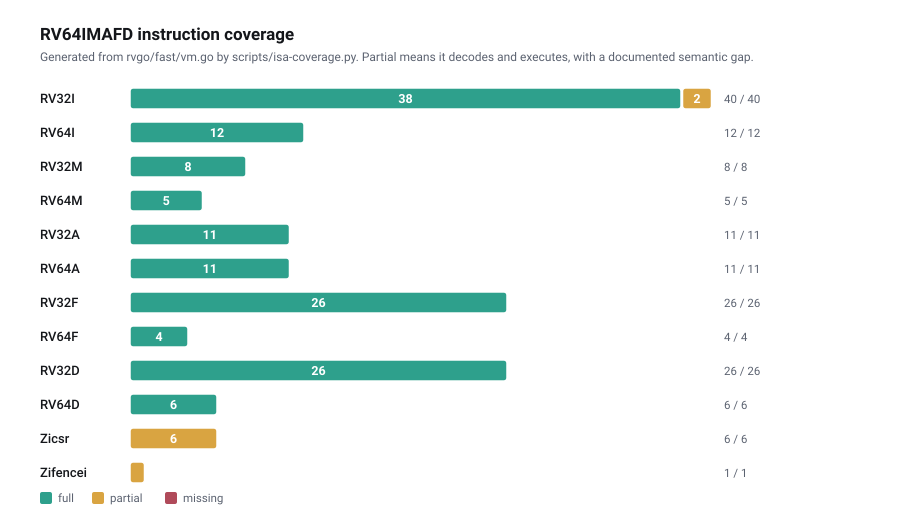

# Instruction set support

MLVM implements **RV64IMAFD**: the 64-bit base integer set plus multiply/divide, atomics,
and single- and double-precision floating point. All 156 instructions decode and execute.
9 of them have a documented semantic gap, listed below.



Regenerate this table from the VM source at any time:

```bash
make isa                          # human-readable
./scripts/isa-coverage.py --markdown
```

The script reads `rvgo/fast/vm.go` rather than a hand-maintained list, so its
output cannot drift from the implementation. The copy below was regenerated from it on
2026-10-16; if the two disagree, the script is right.

---

## Coverage

| Extension | Full | Partial | Missing | What it is |
| --- | ---: | ---: | ---: | --- |
| `RV32I` | 38 | 2 | 0 | base integer |
| `RV64I` | 12 | 0 | 0 | 64-bit widening ops |
| `RV32M` | 8 | 0 | 0 | multiply / divide |
| `RV64M` | 5 | 0 | 0 | 64-bit multiply / divide |
| `RV32A` | 11 | 0 | 0 | atomics, LR/SC |
| `RV64A` | 11 | 0 | 0 | 64-bit atomics |
| `RV32F` | 26 | 0 | 0 | single-precision float |
| `RV64F` | 4 | 0 | 0 | 64-bit float conversions |
| `RV32D` | 26 | 0 | 0 | double-precision float |
| `RV64D` | 6 | 0 | 0 | 64-bit double conversions |
| `Zicsr` | 0 | 6 | 0 | control and status registers |
| `Zifencei` | 0 | 1 | 0 | instruction-fetch fence |
| **Total** | **147** | **9** | **0** | |

### Not implemented, by design

| Extension | Why |
| --- | --- |
| **RVC** (compressed) | 2-byte instructions would double the decoder and every proof would have to handle unaligned fetch. **Build guests with `-march=rv64imafd`, no `c`** — an RVC binary reverts at step 0 with `unknown instruction opcode: 1`. |
| **Privileged ISA** | There is no kernel, no MMU, no trap delegation. `ECALL` is dispatched directly. |
| **RV32/64Q** (quad float) | No ML framework uses binary128. |
| **V** (vector) | Would be valuable for inference throughput and is the most interesting extension to add. Nothing in the design precludes it. |
| **Zfh** (half float) | SoftFloat's `f16` operations *are* ported in `rvgo/comp` — the decoder side is simply not wired up yet. This is the cheapest extension to add, and directly useful for quantised inference. |

---

## Floating point

This is what distinguishes MLVM from its upstream. Asterisc explicitly declines floating
point:

> `RV{32,64}{D,F,Q}`: no-op: No floating points support (since no IEEE754 determinism with
> rounding modes etc., nor worth the complexity)

MLVM implements it anyway, because a machine that cannot multiply two floats cannot run a
neural network.

### How

Every F and D instruction is executed by [`rvgo/comp`](../rvgo/comp) — a Go port
of [Berkeley SoftFloat 3](http://www.jhauser.us/arithmetic/SoftFloat.html), 121 files and
about 5,800 lines, plus support types in `rvgo/include` and RISC-V NaN specialisation in
`rvgo/riscv`.

The host FPU is never touched. Rounding follows the instruction: an `rm` field of 0–4
selects RNE, RTZ, RDN, RUP or RMM for that instruction, and `rm = 7` (dynamic) uses `frm`
from `fcsr`. A reserved static mode (5 or 6), or a dynamic `frm` above 4, reverts the step.
`fcsr` starts at zero, so a program that never writes `frm` and uses dynamic rounding — the
compiler default — runs in round-to-nearest-even. NaN results are canonical. Two machines
with different FPUs produce identical results because neither one's FPU is involved.

### Conformance

The floating-point suites from
[riscv-tests](https://github.com/riscv-software-src/riscv-tests) run under `make test-fd`.
Read this table carefully — the `rv32*` suites are not counted as passes, and the reason
matters:

| Suite family | Pass | Known-failing | Not applicable |
| --- | ---: | ---: | ---: |
| `rv64uf-p-*` (single) | 11 | 0 | — |
| `rv64ud-p-*` (double) | 12 | 0 | — |
| `rv32uf-p-*`, `rv32ud-p-*` | — | — | 21 |
| **Total** | **23** | **0** | **21** |

**All 23 applicable suites pass.** The 21 `rv32*` suites are *not* passes: on an RV64
machine they begin with an XLEN probe (`li a0,1; slli a0,a0,31; bltz a0,<body>`) that is
only taken when XLEN is 32, so they jump straight to `exit(0)` after ~68 steps without
executing a single float instruction. The test harness classifies them explicitly and
asserts they stay that short, rather than counting them as coverage.

This was 9 of 23. Eleven of the fourteen failures shared one root cause: the computed value
was bit-correct and the suite failed only on a `fsflags` check, because the exception flags
were never raised and `frm` was ignored. The other three were `FMIN`/`FMAX` NaN selection
and NaN-boxing.

`fdKnownFailures` in [`rvgo/test/vm_test.go`](../rvgo/test/vm_test.go) is now
empty, but the mechanism is kept: a listed suite is asserted to *still* fail, so a fix shows
up as a test error telling you to remove the entry. That is what caught each of the fourteen
as it landed.

### Determinism in practice

Conformance is one thing; agreeing with real hardware is another. `make determinism`
compiles the same C source twice — once for RV64IMAFD, once for your host — runs one in
the VM and one natively, and diffs the output:

```
=== ieee ===============================================
IDENTICAL - MLVM softfloat == host FPU, byte for byte
    sum       = 3.8956542839085366
    product   = -0.82400427912558161
    sqrt(sum) = 1.9737411896975086
    subnormal = 5.5626846462679985e-309
    underflow = 2.1849137534174492e-08
```

Bit-exact through about 16,000 dependent operations including gradual underflow into the
subnormal range. See [BENCHMARKS.md](BENCHMARKS.md#floating-point-determinism) for the
cases that do diverge and why.

---

## Known gaps

### ~~1. `fcsr` is hardwired to zero~~ — fixed

`fflags`, `frm` and `fcsr` are implemented, in all three VMs. The register is part of the
state witness (which grew from 634 to 642 bytes when `fcsr` was added, and is now 674 bytes
with the staged-file metadata digest), so a CSR read or write of `fcsr` is an ordinary
transition that all three implementations step identically. Flags raised by float
*arithmetic* are produced only by the fast VM; the slow VM and `RISCV.sol` revert on that
arithmetic (see [ARCHITECTURE.md](ARCHITECTURE.md#three-vms-one-semantics)).

The port had dropped more than the CSR plumbing. `Softfloat_roundPackToF64` hardcoded
round-to-nearest-even and discarded the `inexact`, `underflow` and `overflow` raises;
every integer-rounding helper did the same; and the invalid/divide-by-zero raises were
present only as `// invalid` comments. All of that is restored, so **the static rounding
mode encoded in an instruction now takes effect**, and so does a dynamic `frm` —
`fcvt.l.d ..., rtz` really truncates rather than silently rounding to nearest.

Finding them turned up one more dropped raise that no conformance suite exercises:
`0 × ∞` returned the canonical NaN without raising `invalid`. That one was caught by the
float sub-game's differential harness, not by the suites.

**Unimplemented CSRs still read as zero and ignore writes.** That is a real limitation
rather than a safe default, but it cannot be tightened: this machine has no privilege
levels and no trap handling, and guest startup code legitimately touches machine CSRs —
the riscv-tests preamble alone reads `mhartid` and writes `mtvec`. All three
implementations agree on the behaviour, which is what soundness requires.

### ~~2. `FMIN`/`FMAX` NaN selection~~ — fixed

They were implemented as `F64_lt(a, b) ? a : b`, which is wrong in three ways. RISC-V returns
the *non*-NaN operand when exactly one input is NaN (a comparison propagates the NaN
instead); raises invalid only for a *signalling* NaN (routing through `f64_lt` raised it for
any NaN); and orders `-0.0` below `+0.0` even though they compare equal, so
`FMIN(-0.0, +0.0)` must be `-0.0` rather than whichever operand the tie-break happens to
pick. `comp/f64_minmax.go` implements the RISC-V rule directly.

### ~~3. NaN-boxing~~ — fixed

A 64-bit float register holds a valid single-precision value only if its upper 32 bits are
all ones; a single-precision instruction reading anything else must see the canonical NaN
`0x7FC00000`. MLVM masked to the low 32 bits without checking the box, so a single-precision
operation on a register holding a double silently computed on the double's low half.

Both halves are now implemented — unboxing on read and boxing on write — in the fast VM for
every single-precision instruction, and in `slow/vm.go` and `RISCV.sol` for the
bit-manipulation subset they execute (`FLW`, `FSGNJ*.S`, `FMV.W.X`).
`FCVT.S.D` and `FMV.W.X` had their boxing commented out with a `// correct?` note; they
produce singles, so they box. `FMV.X.W` deliberately does not check the box, because the spec
defines it as a transfer in which "the bits are not modified".

### ~~4. FMADD is not fused~~ — fixed

`FMADD` and its three siblings were computed as `F64_add(F64_mul(a, b), c)`: two roundings
where the hardware and the spec do one. `Softfloat_mulAddF64` had been ported all along and
was simply never called; wiring it in was a four-line change per opcode.

RISC-V negates the product for `FNMSUB`/`FNMADD` and the addend for `FMSUB`/`FNMADD`.
Berkeley's `mulAdd` takes an op field that offers one negation or the other but not both, so
all four go through `op = 0` with the sign bits of `a` and `c` flipped as needed — which is
what the RISC-V reference implementation does, and is safe on NaN operands because every NaN
result is canonicalised anyway.

The port had also dropped the `invalid` raise on the `infProdArg` path — an infinite product
with a zero factor, or an infinite product added to the opposite infinity.

**Measured effect on real output, and it splits in two.** `examples/mlp.c` diverged from a
native run by ~13 units in the last place; fusing brings it to **1 ULP**. The five transformer
models did not move at all — every score is bit-identical before and after, still 3–19 ULP
from native.

The difference is where the multiply-adds come from. C compiled against glibc gets them from
libm's polynomial evaluation, so fusing them matters. Rust does not contract `a*b + c` unless
asked, so candle's kernels never emitted them and both sides of that comparison already
agreed. See [BENCHMARKS.md](BENCHMARKS.md#floating-point-determinism).

### 5. Fences and `EBREAK` are no-ops

`FENCE`, `FENCE.TSO`, `FENCE.I` and `EBREAK` decode and advance the PC without doing
anything. This is correct, not a gap: one hart, no store buffer, no instruction cache, no
debugger. Listed as "partial" only because they do not do what the mnemonic literally
describes.

---

## Full partial-instruction list

| Instruction | Gap |
| --- | --- |
| `CSRRW` `CSRRS` `CSRRC` `CSRRWI` `CSRRSI` `CSRRCI` | `fcsr`/`fflags`/`frm` fully implemented; every other CSR reads as 0 and ignores writes |
| `FENCE` | no-op — single hart, no store buffer |
| `FENCE.I` | no-op — no instruction cache |
| `EBREAK` | no-op — no debugger |

---

## Adding an instruction

`fast/vm.go` is a single switch on the opcode. To add one:

1. **Decode it** — add or extend a `case` in `riscvStep()`, using the `parse*` helpers in
   `fast/parse.go`.
2. **Express it in the shared vocabulary** — `add64`, `shl64`, `signExtend64` from
   `fast/yul64.go`, or a `comp` SoftFloat call. Do not use Go's native arithmetic on
   floats; the point is that the host FPU is never involved.
3. **Label it** with a `// funct = MNEMONIC` comment. `scripts/isa-coverage.py` reads
   these, so an unlabelled instruction under-reports rather than over-reports.
4. **Test it** — drop the matching `riscv-tests` binary into `tests/riscv-tests/`
   and add the category to `TestFastStep`.
5. **Mirror it** into `slow/vm.go` and `rvsol/src/RISCV.sol`, or it cannot settle a dispute
   on chain. See [ARCHITECTURE.md](ARCHITECTURE.md#three-vms-one-semantics) for the current
   state of that mirror.

---

## References

- [RISC-V unprivileged ISA specification](https://riscv.org/technical/specifications/)
- [RISC-V instruction reference](https://msyksphinz-self.github.io/riscv-isadoc/html/index.html)
- [Berkeley SoftFloat](http://www.jhauser.us/arithmetic/SoftFloat.html) — the source of `rvgo/comp`
- [riscv-tests](https://github.com/riscv-software-src/riscv-tests) — the conformance vectors
